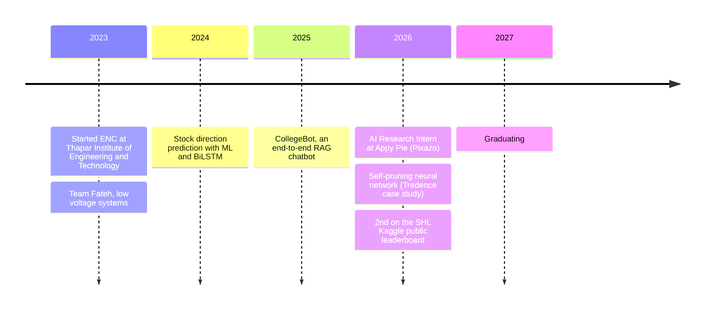

<div align="center">


<p>
  <a href="https://github.com/Techy-A/Techy-A/blob/main/AryanAwasthi.pdf"></a>
  <a href="https://www.linkedin.com/in/aryan--awasthi"></a>
  <a href="mailto:aryanawasthi017@gmail.com"></a>
  <a href="https://github.com/Techy-A/shl-grammar-scoring"></a>
</p>

<p>
  
  
  
</p>

</div>

## About me

```python
class AryanAwasthi:
    studying  = "ENC @ Thapar Institute of Engineering and Technology, 2023 to 2027"
    based_in  = "New Delhi, India"
    last_role = "AI Research Intern, Data & Model Evaluation @ Appy Pie (Pixazo)"
    works_on  = ["statistical model evaluation", "cost and product analytics",
                 "speech and audio ML", "RAG and LLM fine-tuning"]
    pipeline  = ["SQL", "dashboards", "statistics", "Python", "PyTorch", "production"]
    proudest  = "2nd on the public leaderboard, SHL Hiring Assessment 2026 (Kaggle)"

    def say_hi(self):
        return "Open to ML, data and analytics internships and new-grad roles. Let's talk."
```

## Journey



## Experience

<table>
<tr>
<td>

**AI Research Intern, Data & Model Evaluation** at **Appy Pie (Pixazo)**, Noida &nbsp;&middot;&nbsp; *Jun 2026 to Jul 2026*

| | |
|:--|:--|
| **Model leaderboard** | Built a statistical evaluation system (Elo, Bradley-Terry MLE, bootstrap confidence intervals) over **1,050 match-ups across 15 models**. Caught **3 broken scoring signals** and a leaderboard discrepancy before launch. |
| **Cost analytics** | Shipped a **22-panel React dashboard** with live per-model cost, an Elo-per-dollar ranking and a quality-vs-cost Pareto frontier that became the team's reference for model purchasing. |
| **API forensics** | Probed **6+ production model endpoints** and documented hidden behaviour (a 14-image input limit, async submit-then-poll, field-name mismatches), correcting the public API reference. |
| **Docs audit** | Audited a **73-model catalog** across image, video, audio and 3D, surfacing a rendering bug on every model page and fixing pricing inconsistencies. |
| **Process** | Replaced manual reporting with an automated cost-tracking pipeline covering **15+ models across 6 modalities**. |

</td>
</tr>
</table>

## Highlight: scoring spoken grammar from audio

> What the speaker said: *"he **don't** like it"*. What Whisper wrote: *"he **doesn't** like it"*.
> Speech recognisers fix grammar by default, which erases the very errors this model has to score.

<table>
<tr>
<td width="60%">

**[shl-grammar-scoring](https://github.com/Techy-A/shl-grammar-scoring)** listens to 45 to 60 seconds of spontaneous English and predicts a 0 to 5 grammar score.

- Verbatim-prompted Whisper, WavLM, DeBERTa and the Voxtral audio LLM, blended
- Speaker-grouped CV, training on test-length crops, a measured test-set bias correction
- Every leaderboard submission and probe documented, including the ones that failed

</td>
<td width="40%" align="center">

| Metric | Result |
|:--|:--|
| Public leaderboard | **0.3207** (2nd) |
| Out-of-fold RMSE | **0.516** |
| Out-of-fold Pearson r | **0.909** |

</td>
</tr>
</table>

## Projects

| Project | What it does | Numbers |
|:--|:--|:--|
| [**CollegeBot**](https://github.com/Techy-A/collegebot-rag) | End-to-end RAG chatbot: LangChain, ChromaDB and sentence-transformers, with Phi-3-mini, Mistral-7B and GPT-3.5-turbo, QLoRA fine-tuning and a Streamlit app | **92%** faithfulness, **87%** answer relevance, **91%** context precision |
| [**Self-Pruning Neural Network**](https://github.com/Techy-A/Self-Pruning-Neural-Network---Tredence-Analytics) | PyTorch network on CIFAR-10 where every weight has a learnable gate, so the model sparsifies itself while it trains. Tredence AI Engineering case study | Sparse model, no separate pruning step |
| [**Stock Market Direction**](https://github.com/Techy-A/Stock-Market-Prediction-Analysis) | 5 years of market data, 50+ features (RSI, MACD, Bollinger Bands, lags), Random Forest vs XGBoost vs BiLSTM with time-aware validation, plus a backtester | Sharpe ratio, returns and drawdown |
| [**Plato Sniper**](https://github.com/Amritesh-Bhardwaj/Poker) | Poker decision engine: Monte Carlo hand equity under incomplete information, compared against pot odds for GTO-inspired actions | 1,500+ simulated trials per decision |
| [**LORA_for_GPU**](https://github.com/Techy-A/LORA_for_GPU) | Parameter-efficient LLM fine-tuning with LoRA on a single GPU | |
| [**OptiVector**](https://github.com/Techy-A/OptiVector) | Turns PNG and JPG raster images into clean, scalable vector paths | |

<details>
<summary><b>More: classic machine learning</b></summary>
<br />

| Project | What it does |
|:--|:--|
| [MNIST-784 classification](https://github.com/Techy-A/Classification-on-MNIST-784-) | Classical ML vs CNNs on handwritten digits, up to 99% accuracy |
| [California housing](https://github.com/Techy-A/California-Housing-ml) | Price regression with preprocessing, visualisation and model comparison |
| [Iris classification](https://github.com/Techy-A/Classification-of-iris-flower) | Supervised classification of the three iris species |
| [IMAGE-LLP-VISION](https://github.com/Techy-A/IMAGE-LLP-VISION) | Computer vision experiments |

</details>

## Toolbox

<div align="center">


<br />


</div>

| Area | What I use |
|:--|:--|
| **ML and GenAI** | PyTorch, TensorFlow/Keras, scikit-learn, XGBoost, LangChain, RAG, QLoRA/PEFT, BiLSTM, Hugging Face |
| **Statistics** | Elo and Bradley-Terry ratings, hypothesis testing, bootstrap confidence intervals, time-series evaluation, F1 / ROC-AUC / precision / recall |
| **Data and BI** | SQL, PostgreSQL, MongoDB, BigQuery, Power BI, Excel and Google Sheets automation, pandas, NumPy |
| **Product analytics** | Google Analytics, Mixpanel, Hotjar, MS Clarity, Figma |
| **Engineering** | Python, C++, JavaScript, FastAPI, Flask, Django, Streamlit, Docker, Kubernetes, AWS, Git |

## Education and achievements

| | |
|:--|:--|
| **Thapar Institute of Engineering and Technology**, Patiala | B.E. ENC (Electronics and Computer Engineering), 2023 to 2027 (expected) |
| **Kaggle: SHL Hiring Assessment 2026** | 2nd on the public leaderboard (RMSE 0.3207) |
| **JEE Mains 2023** | 92.2 percentile |
| **Team Fateh**, low voltage systems | MPU-6050 gyroscope sensor system for driver indications (direction, speed, temperature); PCB design and system-level debugging |

## GitHub in numbers

<div align="center">


</div>

<div align="center">

**Let's build something.** Reach me on [LinkedIn](https://www.linkedin.com/in/aryan--awasthi) or at [aryanawasthi017@gmail.com](mailto:aryanawasthi017@gmail.com).

</div>


